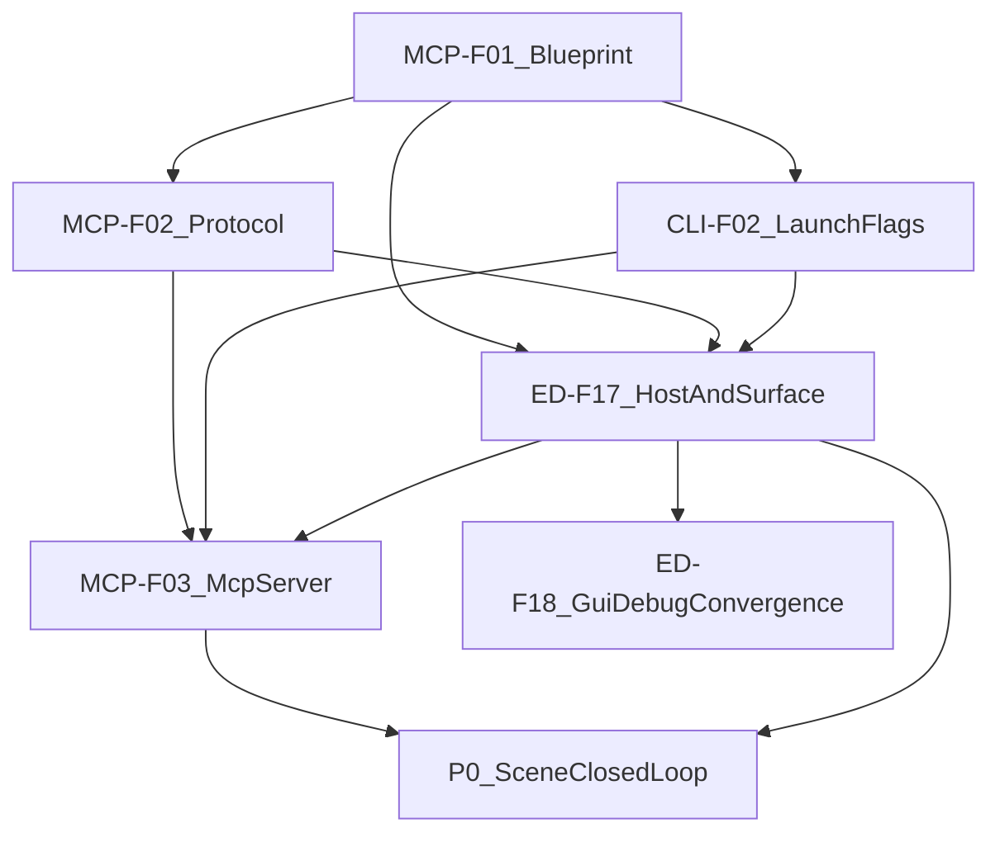
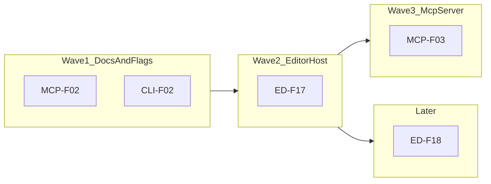

# MCP-F01 — minEngine MCP 总体架构（产品蓝图）— Design Spec

## Meta
- **ID:** `MCP-F01`
- **Type:** Feature（伞形 / 程序级）
- **Status:** Done（P0 竖切：F02/CLI-F02/ED-F17/F03 已落地；Cursor MCP 验收 PASS）
- **Owner:** project maintainer
- **Last updated:** 2026-09-18（伞收口 Done）
- **Branch:** `feat/mcp`
- **Depends on:**
  - `ED-F12` / `ED-F13` / `ED-F14` Done（命令面与 Session；本蓝图将「核」上收为 Q/E/V）
  - `ED-F11` Session 模型
  - `CLI-F01` Done；启动面见 `CLI-F02`
- **Related:**
  - 子 Feature：[ED-F17](../ED-F17_AUTOMATION_HOST_DESIGN.md) · [MCP-F02](./MCP-F02_AUTOMATION_PROTOCOL_DESIGN.md) · [MCP-F03](./MCP-F03_MCP_SERVER_DESIGN.md) · [CLI-F02](../../Platform/CLI/CLI-F02_AUTOMATION_LAUNCH_DESIGN.md) · [ED-F18](../ED-F18_GUI_DEBUG_DOMAIN_SERVICE_CONVERGENCE_DESIGN.md)（挂账）
  - 口径锚点：[ED-F12](../ED-F12_AGENT_EDIT_PROTOCOL_DESIGN.md)（Edit 路径仍多用 EditorCommand）
  - 外部参考（非权威）：`docs/external/minEngine_MCP_Server_Architecture_Design_Guide.md`
  - 哲学：[ENGINE_DESIGN_PHILOSOPHY.md](../../ENGINE_DESIGN_PHILOSOPHY.md) § Agent-Friendly
- **Product names:**
  - 编辑器产品：**Maximum**
  - MCP 进程产品：**minEngine MCP Server**（**不**用 Maximum 前缀绑死命名）

## TL;DR

长期要建的是一套 **Editor 开放能力面**（Query / Edit / Verify），供 GUI、Debug、测试、**minEngine MCP Server** 共用。MCP 只做协议适配，不发明第二套业务 API。进程上：Agent ↔ MCP（stdio）↔ Maximum（Named Pipe JSON）。MVP 同时支持 **拉起 Editor 再连** 与 **连已运行 Editor**；第一竖切跑通 **Scene**；Tools 用少量「粗工具 + 参数」而非一操作一 Tool。

## Scope
- **In:** 产品级分层与关系、状态机、数据/控制流、核心类型草案、长期演进阶段、MVP 切片边界、命名
- **Out:** 具体 C++/TS 实现、完整 op 清单定稿（细节在 F02/F03）、非本地远程多机（可预留）

## Reader quick start
1. §0 名词（MCP / IPC）— 不熟协议时先读
2. **§3.5 同源模型（GUI / Debug / MCP）— 维护者最关心的接口问题**
3. §3 核心模型：Q/E/V + 关系图
4. §4 状态 / 数据流 / 控制流
5. §5 长期阶段 vs §6 MVP
6. **§7 类型与接口** · **§8 Feature 拓扑** · §12 已拍板决策

---

## 0) 名词：MCP 与 IPC（给维护者）

### 0.1 什么是 MCP（Model Context Protocol）

可以把它想成：**AI 客户端（如 Cursor）和「工具程序」之间约定好的插座标准**。

| 角色 | 类比 | 在本项目中 |
|------|------|------------|
| **MCP Client** | 插排上的电器（Cursor / Agent） | Cursor |
| **MCP Server** | 插在插座上的适配器盒子 | **minEngine MCP Server**（Node/TS） |
| **Tool** | 盒子对外提供的按钮（带参数说明） | 如 `editor_query` / `editor_edit` |
| **Resource** | 只读资料卡（可选） | 项目/会话摘要 |
| **stdio transport** | Client 与 Server 用标准输入输出说话 | Cursor 启动我们的 `node` 进程后，双方在管道里交换 JSON |

Agent **不会**直接操作 Maximum 内存；它只能按 MCP 规则调用我们登记的 Tools。

### 0.2 什么是 IPC（Inter-Process Communication）

**两个进程之间传消息。** 本设计里有两段：

```text
[Cursor]  --stdio(MCP)--  [minEngine MCP Server]  --Named Pipe(JSON)--  [Maximum.exe]
   进程A                      进程B                                      进程C
```

- **stdio：** 父子进程常见通道；MCP SDK 已封装。
- **Named Pipe（命名管道）：** Windows 上「起个名字的管道文件」，两边按名字找到对方发字节流。我们在上面跑 **Automation Protocol**（自己的 JSON 约定，见 MCP-F02）。

为什么不让 Cursor 直接连 Maximum？  
因为 Maximum 是 C++ 编辑器；MCP SDK、Schema、Tool 目录更适合放在独立的 TS 进程，且 **Maximum 可以关着 GUI 逻辑边界，只暴露稳定 API**。

### 0.3 一句话分层

> **MCP** = Agent 怎么发现/调用工具。  
> **Automation Protocol** = MCP Server 怎么跟 Maximum 说话。  
> **Editor Q/E/V API** = Maximum 里真正「能查、能改、能验」的能力（真源）。

---

## Pre-flight（2026-09-17 · 修订）

| 项 | 结论 |
|----|------|
| 扫描 | ED-F12–14 有 Edit（Command）强；Query/Verify 作为一等开放面仍弱 |
| 前置 | Scene Edit **sound**；Q/V 需显式设计 |
| 债 | **medium** — 若只把 EditorCommand 当核，Query/Verify 会继续散落 |
| 建议 | **Go Design** — 核 = Editor Automation Surface（Q/E/V）；Command 是 Edit 的主实现手段 |

---

## 1) 背景与目标

### 1.1 Pain
- Agent 无法稳定操作 Maximum。
- 若 MCP 自造业务语义，将与 GUI/Debug 分叉。
- 仅以 EditorCommand 为核，**读状态与校验**没有对等的一等公民。

### 1.2 产品目标（长期）

建设 **Agent-friendly Editor Automation Infrastructure**：

- 人类与 Agent **共存**于同一编辑器进程与同一 Session Undo。
- 所有外部自动化（MCP、测试、未来脚本）调用 **同一套 Editor 开放 API**。
- 覆盖多资产域：Scene → Asset → Material Graph → Anim Graph → Prefab → UI → Project/Settings…
- 可查询、可定位（Guid）、可修改、可验证、可保存、可诊断错误。

### 1.3 非目标（长期也不做的）
- 独立「Agent Framework」双轨 API（违背设计哲学）。
- MCP 直链 `minEngine.dll` / 点 ImGui / 靠显示名当身份。
- 第一版任意代码执行后门。

---

## 2) 现状（可复用）

| 能力 | 状态 | 归入 Q/E/V |
|------|------|------------|
| `EditorCommand` + Session 栈 | 有 | **Edit** 主路径 |
| Scene 域命令覆盖 | 有 | Edit |
| DebugCommand / PayloadJson | 有 | 人类前端；**非** Agent 真源 |
| Document Session | 有 | 所有 Q/E/V 的寻址上下文 |
| Reflection / Guid / PropertyPath | 有 | Query + Edit |
| 统一 Validation 服务 | 弱/散 | **Verify** 需补齐 |
| Named Pipe Host / MCP Server | 无 | 本程序新增 |

---

## 3) 核心模型

### 3.1 真源：Editor Automation Surface（Q / E / V）

```text
                    ┌─────────────────────────────────────────┐
                    │     Editor Automation Surface           │
                    │  （Maximum 内稳定开放能力；真源）          │
                    │                                         │
                    │  Query   — 只读；无副作用（或仅诊断缓存） │
                    │  Edit    — 有副作用；优先进 Session Undo │
                    │  Verify  — 检查一致性；结构化 issues     │
                    └─────────────────────────────────────────┘
                         ▲            ▲            ▲
                         │            │            │
              GUI / DebugCommand /  Tests /  minEngine MCP Server
              （前端：把意图变成对 Surface 的调用）
```

| 面 | 含义 | 典型实现（Maximum 内） |
|----|------|------------------------|
| **Query** | 读项目/会话/对象/属性/图结构 | Query Service；**不**入 Undo |
| **Edit** | 创建/删除/改属性/改拓扑/Save… | 多数 → `EditorCommand` → CommandStack；少数系统 op（Save）可标记 non-undo |
| **Verify** | 校验引用、路径、图完整性、脏状态约定等 | Validation Service；返回 issues[] |

**与 ED-F12 的关系（校准，非推翻）：**

- ED-F12「EditorCommand 单核心」仍正确描述 **Edit 路径**。
- 本蓝图把「核」**上收一层**：Agent/MCP 面对的是 **Q/E/V API**；EditorCommand 是 Edit 的主要机制，不是 Query/Verify 的全部。

### 3.2 进程与产品关系

```text
┌──────────────┐     MCP (stdio)      ┌──────────────────────────┐
│ Cursor/Agent │ ◄──────────────────► │ minEngine MCP Server     │
│ (MCP Client) │                      │ (Node/TS · MCP-F03)      │
└──────────────┘                      │  Tools / Resources      │
                                      │  Connection Manager     │
                                      └───────────┬──────────────┘
                                                  │ Automation Protocol
                                                  │ JSON over Named Pipe
                                                  ▼
                                      ┌──────────────────────────┐
                                      │ Maximum.exe              │
                                      │  Automation Host(ED-F17) │
                                      │  → Q / E / V Surface     │
                                      │  → Session / Reflection  │
                                      └──────────────────────────┘
```

| 组件 | 产品名 | 职责 |
|------|--------|------|
| MCP Server | **minEngine MCP Server** | Agent 可见的 Tools；连接/拉起 Maximum；协议翻译 |
| Editor | **Maximum** | 真实编辑；Q/E/V；Undo；资产 |
| Protocol | Automation Protocol | 与 MCP 解耦的 JSON 契约（MCP-F02） |

### 3.3 连接模式（MVP 两种都要）

| 模式 | 谁启动 Maximum | MCP Server 做什么 | 典型场景 |
|------|----------------|-------------------|----------|
| **Spawn** | Agent / MCP Server 经 CLI | 起进程 → 等 ready → 连接 pipe | 无人开着编辑器 |
| **Attach** | 人类已开 Maximum（带 automation） | 发现/指定 pipe → 连接 | 人在调 UI，Agent 协助 |

两种模式 **共享同一 Protocol 与同一 Q/E/V**；差别只在 Connection Manager 的启动/发现策略（CLI-F02 + MCP-F03）。

```text
Spawn:  Agent → MCP:editor_connect(spawn) → CLI Maximum → ready → pipe connect
Attach: Agent → MCP:editor_connect(attach, pipeName) → pipe connect
```

### 3.4 Agent ↔ MCP ↔ Editor 接口分层（回答「包到哪一层」）

用三层看，避免把「包装 EditorCommand」想成 MCP 专用外壳：

```text
┌─────────────────────────────────────────────────────────────┐
│ L3  Agent 可见面 — minEngine MCP Server                     │
│     粗 Tools: editor_connect / editor_query / editor_edit / │
│               editor_verify / editor_get_state              │
│     只做：参数校验、连接、把 domain+action 译成协议 JSON      │
│     不做：Scene 业务、Undo、对象生命周期                      │
└───────────────────────────┬─────────────────────────────────┘
                            │ Automation Protocol（JSON / Pipe）
┌───────────────────────────▼─────────────────────────────────┐
│ L2  传输与调度 — Automation Host（ED-F17）                   │
│     收包 → 主线程 → 调用 L1                                  │
│     不做：第二套 Edit 语义                                   │
└───────────────────────────┬─────────────────────────────────┘
                            │ 进程内 C++ 调用
┌───────────────────────────▼─────────────────────────────────┐
│ L1  同源操作面 — Editor Automation Surface（Q / E / V）      │
│     ★ 所有前端最终都应落到这里（或落到 L1 背后的域服务）        │
│     Edit：显式参数 → 工厂构造 EditorCommand → Session 栈     │
│     Query / Verify：域只读/校验服务（与 GUI 读路径同源数据）    │
└───────────────────────────┬─────────────────────────────────┘
                            │
┌───────────────────────────▼─────────────────────────────────┐
│ L0  引擎 / 文档真源                                          │
│     Scene · Reflection · Asset · Document Session · Undo…   │
└─────────────────────────────────────────────────────────────┘
```

| 前端 | 应如何进入 L1 | 禁止 |
|------|----------------|------|
| **GUI** | 点击后调用域 Edit/Query API（或共享工厂），再入栈 | 长期直写内存绕过 Command（ED-F13/F14 已在收敛） |
| **DebugCommand** | 字符串解析 → **同一套** L1/工厂（显式 Guid/path） | 把 REPL 字符串当成 MCP/协议真源 |
| **MCP** | Tool → Protocol → Host → **同一套** L1 | 在 TS 里实现「半套编辑器」 |
| **Tests** | 可直接调 L1 或工厂 | 为测 MCP 另写改世界路径 |

**EditorCommand 要包到什么程度？**

| 包法 | 含义 | 结论 |
|------|------|------|
| A. 为 MCP 再包一层 `McpSetPropertyCommand` | 双轨 | **否决** |
| B. Protocol/Host 里 `new EditorSetObjectPropertyCommand` 后直改世界 | 漏掉与 GUI 共享的校验/工厂 | **弱；仅过渡** |
| C. **域服务 / Surface.Edit** 统一：`SetObjectProperty(session, guid, path, value)` 内部负责校验 + `new Command` + `stack.Execute` | GUI/Debug/MCP/测试都调它 | **选用（同源点）** |

一句话：

> **不是「给 EditorCommand 做 MCP 包装」；而是「所有人（含 GUI）共用域级 Q/E/V API，Edit API 内部才使用 EditorCommand」。**  
> MCP 只是远距离按下同一个按钮。

这与 ED-F12「多前端、单命令核」一致，并把核 **上收** 到 Q/E/V，使 Query/Verify 也有对等入口（不必硬塞成 Undo Command）。

### 3.5 同源意图（维护者问题的直接回答）

**是的，理解你的设计意图：**

对引擎/编辑器内核而言，一次「改 Player 的速度」无论来自 Inspector、Debug `set`、还是 Agent `editor_edit`，最终应是：

1. 同一个 Session  
2. 同一套身份（Guid + PropertyPath）  
3. 同一条 Edit 实现（同一 Command 类型或同一服务方法）  
4. 同一个 Undo 栈条目（适用时）  
5. 同一种错误/校验语义（Verify 可复用）

MCP 与 Debug 的差别只在 **怎么把意图说清楚**（JSON 参数 vs 人类字符串方言），不在 **改世界的那一刀**。

---

## 4) 状态 · 数据流 · 控制流

### 4.1 连接状态机（MCP Server 侧）

```text
                  ┌───────────┐
                  │ Detached  │
                  └─────┬─────┘
           spawn/attach │
                        ▼
                  ┌───────────┐
           ┌─────│ Connecting│──── timeout/fail ──► Failed
           │      └─────┬─────┘
           │            │ ready + pipe ok
           │            ▼
           │      ┌───────────┐
           │      │ Ready     │◄──── reconnect policy（后置）
           │      └─────┬─────┘
           │            │ editor exit / pipe break
           │            ▼
           │      ┌───────────┐
           └─────►│ Detached  │
                  └───────────┘
```

Maximum 侧对应：`AutomationDisabled` → `Listening` → `Ready` →（请求串行服务中）。

### 4.2 控制流（一次 Edit）

```text
Agent
  │ tools/call  editor_edit { domain, action, sessionId, … }
  ▼
minEngine MCP Server
  │ 校验参数（Zod / 缓存的 capabilities）
  │ 组装 Automation Request { kind, op, payload }
  │   （op 主键；kind 须与 CapabilityRegistry 一致）
  │ Named Pipe 发送（默认 RPC 超时 e.g. 30s）
  ▼
Automation Host（IO 线程读包 → 入队）
  │ marshal 到 Editor 主线程
  ▼
IEditorAutomationSurface.Edit(op, ctx, payload)
  │ 查 CapabilityRegistry：未知 op / kind 不匹配 → 失败
  │ 分派 → ISceneEditService.（SetProperty / …）
  │     └── new EditorCommand → Session.CommandStack.Execute
  ▼
Response { ok, result, errors }
  │ 原路返回
  ▼
MCP → Agent（结构化文本/JSON）
```

Query / Verify 同构，但 **不** 推 Undo（除非未来显式「带副作用的诊断」——默认不做）。

### 4.3 数据流（身份与载荷）

```text
持久/运行时身份
  Project → Asset(Guid) → Edit Session(sessionId) → Object(Guid) → PropertyPath → Value

Agent 侧禁止：仅用显示名作为写目标。
名称只出现在 Query 结果里，供人读或二次 resolve（resolve 本身应是 Query）。
```

### 4.4 与人类共存时的一致性

| 规则 | 说明 |
|------|------|
| 同一 Session Undo | Agent Edit 与 GUI Edit 进同一栈（该文档 Session） |
| 显式 sessionId | 不默认「当前 Active Tab」作为写目标 |
| 串行执行（MVP） | Host 对自动化请求单飞；**不**等于与 GUI 输入全局互斥 |
| 人机并发 | Known limitation：无跨 GUI+Host 的总锁；冲突靠同一 Undo / 用户协调 |
| Verify 在 Edit 后 | Agent 工作流推荐：Query → Edit → Verify → Save → Query |

### 4.5 Ready 顺序不变量

```text
Listen(pipe) 成功 →（可选 open-scene 完成）→ 写 ready-file
```

禁止先写 ready-file 再 Listen（否则 MCP 会连上空管）。

### 4.6 本机信任模型（P0）

Named Pipe 对知道名称的本机进程开放。P0：**本机信任**；pipe 名须含 **pid 或随机后缀**，示例勿使用固定全局名。远程/鉴权后置。

---

## 5) 长期演进（产品阶段，非线性 TODO）

| 阶段 | 主题 | 能力增量 |
|------|------|----------|
| **P0 MVP** | Scene 竖切 + 双连接模式 | 粗 Tools（query/edit/verify/…）、Scene Q/E/V 最小集、Save；连接健康检查为内部机制 |
| **P1** | 协议与 Host 硬化 | 错误码完备、超时/取消草案、session 枚举、打开/聚焦文档 |
| **P2** | 多域 Edit | Material / AnimGraph 拓扑与属性（复用 ED-F14 命令面） |
| **P3** | Asset / Prefab / Project | 资产级 Query/Edit、Prefab 实例规则、项目设置 |
| **P4** | DX | Resources 丰富、批处理/事务、权限确认、分页、日志订阅 |
| **P5** | 可选扩展 | 本机多实例发现、TCP（仍本地优先）、无头 Automation（若需要） |

**原则：** 新域 = 扩展 **Editor Q/E/V** + Protocol op 映射 +（通常不增）粗 Tool 参数枚举；**不**为每域复制一套 MCP 业务核心。

---

## 6) MVP 边界（P0）

### 6.0 交付分层（避免一次做爆）

| 层级 | 目标 | 必须 |
|------|------|------|
| **P0-alpha**（首竖切） | 一种连接（**优先 Attach 或 Spawn 先做通一种**）+ `get_state` / `get_property` / `set_property` / `save` | 可手验改属性并保存 |
| **P0-complete** | Spawn **与** Attach；Scene MVP 全 op 表；`get_capabilities` 真拉取；`validate`（诚实 stub 或最少规则） | Scene 闭环脚本 |

拓扑仍按 §8；alpha 可在 ED-F17-B / MCP-F03-B 未铺满 op 时先验收。

### 6.1 P0-complete 必须有
- Spawn **与** Attach
- Scene：Query 层级/对象/属性；Edit 创建/删除/组件/属性/reparent/save；Verify（见 F02 stub 声明）
- 粗 Tools（见 §7.5）
- 显式 `sessionId`（`get_state` 返回 `sessions` + `defaultSessionId`）

### 6.2 明确不做（P0）
- Material/Anim/Prefab Tools 完备
- 远程机器、多 Agent 抢锁 UI
- 任意脚本执行
- 超细粒度「一操作一 Tool」目录
- 跨 GUI+Host 的全局编辑锁

---

## 7) 类型 · 接口 · 命名

> 概念契约；线格式细节以 [MCP-F02](./MCP-F02_AUTOMATION_PROTOCOL_DESIGN.md) 为准；C++ 落点以 [ED-F17](../ED-F17_AUTOMATION_HOST_DESIGN.md) 为准。

### 7.1 命名拍板：`Surface` 而非 `Interface`

| 候选 | 评价 | 结论 |
|------|------|------|
| `IEditorAutomationInterface` | 与 C++ `I*` 前缀叠词；语义空 | **否决** |
| `IEditorAutomationSurface` | 「对外暴露的能力面」；与 API surface 用语一致 | **选用** |
| `IEditorAutomationFacade` | 也可，但偏 GoF 实现模式 | 不用作主名 |
| `IEditorAutomationApi` | 清晰但偏泛 | 可作文档别称 |

**定名：**

- 门面：`IEditorAutomationSurface` / 实现类 `EditorAutomationSurface`
- 域服务：`ISceneQueryService` / `ISceneEditService` / `ISceneVerifyService`
- Host：`AutomationHost`（传输+调度，不是能力真源）

关系：Host → Surface（分派）→ 域 Service（同源）→ EditorCommand（Edit 时）。

GUI / Debug 未改走服务的路径挂账见 [ED-F18](../ED-F18_GUI_DEBUG_DOMAIN_SERVICE_CONVERGENCE_DESIGN.md)（不挡 MCP P0）。

### 7.2 公共身份与结果类型

```ts
type SessionId = string;
type ObjectId = string;       // 引擎 GUID 文本；无 guid:// 强制前缀
type AssetId = string;
type PropertyPath = string;
type RequestId = string;
type ProtocolVersion = 1;

type AutomationKind = "query" | "edit" | "verify";

interface ObjectRef {
  objectId: ObjectId;
  name?: string;
  type?: string;
}

interface SessionRef {
  sessionId: SessionId;
  documentType: string;
  assetId?: AssetId;
  title?: string;
  dirty?: boolean;
}

interface AutomationError {
  code: string;
  message: string;
  objectId?: ObjectId;
  propertyPath?: PropertyPath;
  op?: string;
}

interface AutomationIssue {
  severity: "error" | "warning" | "info";
  code: string;
  message: string;
  objectId?: ObjectId;
  propertyPath?: PropertyPath;
}
```

### 7.3 信封与能力清单

```ts
interface AutomationRequest {
  protocolVersion: ProtocolVersion;
  requestId: RequestId;
  kind: AutomationKind;
  op: string;
  sessionId?: SessionId;
  payload: Record<string, unknown>;
}

interface AutomationResponse {
  protocolVersion: ProtocolVersion;
  requestId: RequestId;
  ok: boolean;
  result?: unknown;
  errors: AutomationError[];
  warnings?: AutomationError[];
}

interface CapabilitiesResult {
  protocolVersion: ProtocolVersion;
  editorProduct: string;
  editorVersion?: string;
  domains: CapabilityDomain[];
}

interface CapabilityDomain {
  name: string;
  actions: CapabilityAction[];
}

interface CapabilityAction {
  name: string;
  kind: AutomationKind;
  op: string;
  description?: string;
  sessionRequired: boolean;
  undo?: boolean;
  inputSchema?: object;
}
```

### 7.4 C++ 侧接口骨架（概念）

```cpp
struct AutomationCallContext {
    SessionId sessionId;
};

struct AutomationResult {
    bool ok = false;
    // json result + errors/warnings — 用项目既有 Json 类型
};

class IEditorAutomationSurface {
public:
    virtual ~IEditorAutomationSurface() = default;
    virtual AutomationResult Query(std::string_view op,
                                   const AutomationCallContext& ctx,
                                   const /*json*/& payload) = 0;
    virtual AutomationResult Edit(std::string_view op,
                                  const AutomationCallContext& ctx,
                                  const /*json*/& payload) = 0;
    virtual AutomationResult Verify(std::string_view op,
                                    const AutomationCallContext& ctx,
                                    const /*json*/& payload) = 0;
};

class ISceneQueryService {
public:
    virtual ~ISceneQueryService() = default;
    virtual AutomationResult GetHierarchy(const SessionId&) = 0;
    virtual AutomationResult GetObject(const SessionId&, const ObjectId&) = 0;
    virtual AutomationResult GetProperty(const SessionId&, const ObjectId&,
                                         const PropertyPath&) = 0;
};

enum class PropertyWritePolicy { Set, Edit };

class ISceneEditService {
public:
    virtual ~ISceneEditService() = default;
    virtual AutomationResult SetProperty(const SessionId&, const ObjectId&,
                                         const PropertyPath&,
                                         const /*json*/& value,
                                         PropertyWritePolicy policy) = 0;
    virtual AutomationResult CreateGameObject(const SessionId&, /*...*/) = 0;
    virtual AutomationResult DeleteGameObject(const SessionId&, const ObjectId&) = 0;
    virtual AutomationResult AddComponent(const SessionId&, const ObjectId&,
                                          std::string_view className) = 0;
    virtual AutomationResult RemoveComponent(const SessionId&, const ObjectId&) = 0;
    virtual AutomationResult Reparent(const SessionId&, const ObjectId& child,
                                      const ObjectId& newParent) = 0;
    virtual AutomationResult Save(const SessionId&) = 0;
};

class ISceneVerifyService {
public:
    virtual ~ISceneVerifyService() = default;
    virtual AutomationResult Validate(const SessionId&) = 0;
};

class ICapabilityRegistry {
public:
    virtual ~ICapabilityRegistry() = default;
    virtual CapabilitiesResult BuildCapabilities() const = 0;
};
```

### 7.5 MCP 粗 Tools（Agent 可见）

| Tool | 作用 |
|------|------|
| `editor_connect` | Spawn / Attach |
| `editor_get_state` | 连接 + sessions |
| `editor_query` | `domain` + `action` + … |
| `editor_edit` | 同上；必填 `sessionId` |
| `editor_verify` | 同上 |

细能力说明来自 `get_capabilities`（Editor 真源）。

### 7.6 仓库落点

```text
schemas/automation/v1/
minEngineMcpServer/
Editor/src/Automation/
Editor/src/Services/Scene/
```

---

## 8) Feature 切分与实现拓扑

### 8.1 归属

| ID | 内容 |
|----|------|
| **MCP-F01** | 本蓝图 |
| **MCP-F02** | 线协议 + 细 op + capabilities 形状 |
| **CLI-F02** | Spawn/Attach flags、ready-file |
| **ED-F17** | Host + Surface + 域服务 + capabilities 注册 |
| **MCP-F03** | minEngine MCP Server |
| **ED-F18** | GUI/Debug 收敛（挂账；不挡 P0） |

### 8.2 依赖拓扑（实现序）



### 8.3 建议切片顺序

| 序 | Feature | 切片目标 | 验证 |
|----|---------|----------|------|
| 1 | MCP-F02 | 信封 + 帧 + Scene op + capabilities 例 + get_state 形状 | Schema/examples 评审 |
| 2 | CLI-F02 | pipe / ready-file / open-scene；Listen→ready 不变量 | help + ready-file |
| 3 | ED-F17-A | Pipe + length-prefix + 内部 ping | 最小客户端往返 |
| 4 | ED-F17-B | IScene*Service + Surface；**P0-alpha：** get/set_property + save | Undo；无 MCP |
| 5 | ED-F17-C | get_capabilities + get_state；铺满 Scene op | JSON 含 scene actions |
| 6 | MCP-F03-A | stdio + editor_connect（可先一种模式） | Cursor 能连 |
| 7 | MCP-F03-B | 粗 Tools + 拉 capabilities；P0-alpha 闭环 | query→edit→save |
| 8 | ED-F18 | GUI/Debug 改调域服务 | P0 后；有空再做 |

### 8.4 并行示意



---

## 9) 备选与否决

| 选项 | 结论 |
|------|------|
| 核 = 仅 EditorCommand | 否决为总核；保留为 Edit 机制 |
| 核 = Q/E/V Surface | **选用** |
| 门面名 `*Interface` | **否决**；用 **`IEditorAutomationSurface`** |
| MCP 产品名 Maximum* | 否决；用 minEngine MCP Server |
| MVP 仅 Spawn | 否决；Spawn+Attach |
| 一操作一 MCP Tool | 否决为默认 |
| 能力表仅手写在 MCP Server | 否决为唯一真源 |

---

## 10) 风险与缓解

| 风险 | 缓解 |
|------|------|
| 粗 Tool 参数爆炸 | capabilities 驱动说明 |
| Q/V 散落 | ED-F17 经 Surface |
| Attach 发现难 | MVP 显式 pipe |
| GUI 未收敛 | ED-F18 挂账 |

---

## 11) 验收标准（伞）

- [x] 命名：`IEditorAutomationSurface` + 域 `IScene*Service`
- [x] Spawn + Attach、粗 Tools、能力真源在 Editor
- [x] §8 拓扑被采纳或修订
- [x] 子 Feature 与本蓝图无冲突（F02/CLI-F02/ED-F17/F03 Done；ED-F18 仍挂账）

---

## 12) 决策记录（已拍板）

| 项 | 决策 |
|----|------|
| GUID 线格式 | 引擎 GUID 文本；不强制 guid:// |
| Pipe 帧定界 | u32 LE length + UTF-8 JSON |
| Ready | ready-file 为主 |
| kind | query / edit / verify |
| Attach 无 automation | 失败 + 可读提示 |
| Agent Tools | 粗 editor_query/edit/verify + connect/state |
| 同源 | GUI/Debug/MCP → L1 域服务 |
| 门面命名 | **IEditorAutomationSurface** |
| 能力真源 | Editor 注册表 + editor.get_capabilities；TS 只缓存拉取结果 |
| **op / kind** | **`op` 为主键**；`kind` 必须与 CapabilityRegistry 一致，否则 `KindOpMismatch` |
| Ready 顺序 | Listen →（open-scene）→ ready-file |
| P0 交付 | 允许 **P0-alpha** 先通再铺满 P0-complete（§6.0） |
| 本机安全 | 本机信任；pipe 名含 pid/随机 |

仍可议（审批时可顺带拍）：pipe 名模板细节、`editor_disconnect`、npm 包名、`open-scene` 路径 vs Guid、MVP 是否只暴露 set、`editor_get_state` 是否并入 `editor_query`。

---

## 变更记录

| 日期 | 说明 |
|------|------|
| 2026-09-17 | 初稿 |
| 2026-09-17 | 产品蓝图；Q/E/V；Spawn+Attach；粗 Tools |
| 2026-09-17 | 同源接口分层；开放点拍板 |
| 2026-09-17 | §7 类型/C++ 骨架；命名选 Surface；§8 实现拓扑 mermaid |
| 2026-09-17 | **评审修补：** op 主键、§4.2 控制流、ready 不变量、P0-alpha、人机并发/本机信任；待审批 |
| 2026-09-18 | 子 Feature 竖切落地 + Cursor/`accept_mcp_path` 验收；**Status → Done** |
